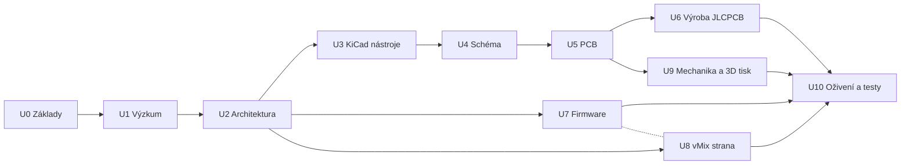

# Plán projektu: vMix Replay Controller (EVS-like)

Vlastní hardwarový ovladač pro **vMix Replay**, který se co nejvíc chová a vypadá jako EVS LSM remote: barevná RGB tlačítka, páka (T-bar) pro rychlost přehrávání, jog kolečko a případně motorizovaný návrat páky. Deska se navrhne v KiCadu, vyrobí a osadí v JLCPCB, ručně se dopájí jen EVS tlačítka a mechanické díly z AliExpressu. Krabička a mechanika páky se tisknou na 3D tiskárně. Firmware a nastavení vMixu dodá Claude.

> Živý přehled stavu je ve vizuálním dashboardu: https://claude.ai/artifact/F6eHfhQ5NSxDFNfWmzDA3g (zdroj stránky je v [docs/dashboard/index.html](dashboard/index.html)). Tento soubor je textová verze plánu, aktualizuje se spolu s dashboardem.

## Jak spolupracujeme

| Kdo | Co dělá |
|---|---|
| **Claude** | rešerše, návrhy, schéma a PCB (přes KiCad MCP nebo generováním souborů), výrobní data, firmware, bridge aplikace, 3D modely, dokumentace |
| **Ty** | spouštění Gemini Deep Research, rozhodnutí a schvalování, instalace na PC, objednávky, pájení, 3D tisk, testování s vMixem |
| **Oba** | rozhodnutí o architektuře, review schématu a desky, testy |

Stavy kroků: `todo` (čeká), `doing` (rozpracováno), `done` (hotovo), `blocked` (zablokováno, čeká na něco jiného).

## Tok projektu

Hardware, firmware, vMix a mechanika běží po rozhodnutí o architektuře **paralelně**. Firmware se začne psát na devboardu (krok 7.1) dřív, než přijde deska, takže až deska dorazí, bude software skoro hotový.

## Rozhodnuto (11. 11. 2026)

- **Zhruba 15 RGB tlačítek** PB26-13M, přesný počet určí layout (viz [hardware/buttons-PB26-13M-RGB.md](hardware/buttons-PB26-13M-RGB.md)).
- **Páka bez motoru**, se snímačem polohy. Navržený snímač: bezkontaktní magnetický snímač úhlu (např. AS5600) na čepu páky, bez opotřebení. Kalibrace jako u EVS: po zapnutí sjet pákou dolů a nahoru, firmware si zapamatuje rozsah. Poslední kalibrace se uloží do flash jako záloha, kdyby se krok vynechal.
- **Napájení z USB-C 5 V**, žádných 230 V uvnitř krabičky. Odhad spotřeby: 15 × 3 × ~8 mA ≈ 0,36 A pro LED, celkem pod 0,5 A, takže stačí běžný USB port.

## Výsledky Deep Research #1

Shrnutí a návrh architektury: [research/DR1-summary.md](research/DR1-summary.md). Navrženo: RP2040/RP2350 + Ethernet (W5500) přímo na vMix TCP API, USB-C pro napájení a servis.

## Výchozí technické poznatky (před Deep Research)

- **vMix nabízí několik cest ovládání:** HTTP Web API, **TCP API na portu 8099** (obousměrné, umí odběr stavů přes `SUBSCRIBE TALLY` a `SUBSCRIBE ACTS`), nativní MIDI mapování s MIDI feedbackem, X-Keys a gamepady. Replay se ovládá shortcut funkcemi typu `ReplayMarkIn`, `ReplayMarkOut`, `ReplayPlay`, `ReplayLive`, `ReplaySetSpeed`, `ReplayJumpFrames` a dalšími.
- **SKAARHOJ** panely komunikují s vMixem přes TCP API po Ethernetu, bez softwaru na PC. To je jedna z kandidátních architektur.
- **Páka přes MIDI** má podle vMix fóra problémy s ovládáním rychlosti replaye, proto bude prototyp (7.1) ověřovat plynulost dřív, než se zafixuje návrh.
- **KiCad MCP:** existuje open-source server [KiCAD-MCP-Server](https://github.com/mixelpixx/KiCAD-MCP-Server) (a další), který umožňuje AI pracovat se schématem a deskou v KiCadu. Ověří se v krocích 1.4 a 3.2.

### Kandidátní architektury (rozhodne se v kroku 2.1)

| Varianta | Princip | Výhody | Nevýhody |
|---|---|---|---|
| A. USB MIDI | Ovladač se hlásí jako MIDI zařízení, mapuje se ve vMixu | Žádný software na PC, jednoduché | Omezený feedback, známé potíže s pákou pro replay |
| B. USB + bridge | USB (CDC/HID) + malá aplikace na PC, ta mluví s TCP API | Plná kontrola, snadné ladění, napájení z USB | Musí běžet aplikace na vMix PC |
| C. Ethernet přímo | MCU + Ethernet (např. W5500) mluví přímo s TCP API | Jako SKAARHOJ, žádný software, robustní | Složitější deska a firmware, potřebuje síť |
| D. Kombinace | Např. Ethernet pro vMix + USB pro napájení a servis | Flexibilní | Nejvíc práce |

## Fáze a kroky

### U0 · Základy projektu

Plán, dashboard, struktura repozitáře a inventář dílů, které už máš.

| # | Krok | Kdo | Stav | Poznámka |
|---|---|---|---|---|
| 0.1 | Fázovaný plán a dashboard | Claude | `done` | Tento plán (docs/PLAN.md) a vizuální dashboard pro sledování postupu. |
| 0.2 | Struktura repozitáře | Claude | `todo` | Složky docs/, hardware/ (KiCad), firmware/, host/ (případný bridge), vmix/ (konfigurace), mechanics/ (STL/STEP). |
| 0.3 | Inventář EVS RGB tlačítek | Ty | `done` | Pošli typ/odkaz, rozměry, výšku, zapojení LED (společná anoda/katoda, nebo adresovatelné), proud LED, typ spínače a ideálně fotky z obou stran. Na tom závisí celé schéma. |
| 0.4 | Seznam přání a priorit | Ty | `done` | Kolik tlačítek, displej ano/ne, motorová páka nutná, nebo nice-to-have, rozpočet, cílová velikost panelu. |

### U1 · Výzkum

Gemini Deep Research: vMix API a replay, EVS LSM, komponenty. Analýza výsledků.

| # | Krok | Kdo | Stav | Poznámka |
|---|---|---|---|---|
| 1.1 | Deep Research #1: vMix API a replay ovladače | Ty | `done` | Spusť prompt v Gemini Deep Research a vlož výsledek do vlákna. Prompt: [docs/research/DR1-vmix-api-prompt.md](research/DR1-vmix-api-prompt.md). |
| 1.2 | Deep Research #2: EVS LSM ovladač | Oba | `todo` | Rozložení, chování páky (rychlostní křivka), jog/shuttle, barvy tlačítek, workflow operátora. Prompt připravím po DR1. |
| 1.3 | Deep Research #3: komponenty a JLCPCB | Oba | `todo` | MCU, Ethernet/USB, ovladače LED, motorové fadery, enkodéry, dostupnost v JLCPCB Basic/Extended. Prompt připravím po DR1. |
| 1.4 | Rešerše KiCad MCP a AI workflow | Claude | `todo` | Ověřit KiCAD-MCP-Server (mixelpixx) a alternativy, co umí (schéma, PCB, export), jak ho napojit. |
| 1.5 | Analýza výsledků a shrnutí | Claude | `todo` | Zpracovat reporty do docs/research/ a připravit podklady pro rozhodnutí. |

### U2 · Architektura a specifikace

Rozhodnutí o komunikaci, MCU, napájení, layoutu panelu a mapování funkcí.

| # | Krok | Kdo | Stav | Poznámka |
|---|---|---|---|---|
| 2.1 | Rozhodnutí: komunikace s vMixem | Oba | `todo` | USB MIDI vs. USB + bridge aplikace na TCP API (port 8099) vs. Ethernet přímo na TCP API (jako SKAARHOJ). Zaznamenat jako ADR. |
| 2.2 | Rozhodnutí: MCU a napájení | Oba | `todo` | RP2040/RP2350 vs. ESP32-S3 vs. STM32. Napájení z USB-C 5 V, případně externí 12 V kvůli motoru, ochrany. |
| 2.3 | Rozhodnutí: páka a jog | Oba | `todo` | Lineární potenciometr vs. motorizovaný fader vs. 3D tištěná páka s magnetickým (hall) senzorem; jog jako optický/mechanický enkodér s detenty nebo bez. |
| 2.4 | Layout panelu ve stylu EVS | Claude | `todo` | Návrh rozmístění tlačítek, páky a jogu (SVG/PDF 1:1), schválíš a případně vytiskneš na papír. |
| 2.5 | Mapa tlačítek na vMix funkce | Claude | `todo` | Tabulka: tlačítko → vMix funkce (ReplayMarkIn, ReplayPlay, ReplayLive, …) → barva LED podle stavu. |
| 2.6 | Specifikace v1 (freeze) | Ty | `todo` | Schválíš specifikaci, pak se kreslí schéma. |

### U3 · KiCad nástroje

KiCad, MCP server pro ovládání KiCadu, JLCPCB knihovny a pluginy.

| # | Krok | Kdo | Stav | Poznámka |
|---|---|---|---|---|
| 3.1 | Instalace KiCad 9 | Ty | `todo` | Nainstalovat KiCad na PC (D:\Projects\VMix-Replay-Controller). |
| 3.2 | Zprovoznit KiCad MCP server | Oba | `todo` | Nainstalovat a připojit KiCad MCP, abych mohl kreslit/upravovat schéma a PCB přímo; jinak generuji soubory a ty je otevíráš. |
| 3.3 | JLCPCB knihovny a pluginy | Oba | `todo` | easyeda2kicad / JLC knihovna, Fabrication Toolkit pro export BOM a CPL, pravidla DRC pro JLCPCB. |

### U4 · Schéma zapojení

MCU, USB-C, napájení, tlačítka a RGB LED, páka, jog, motor, komunikace.

| # | Krok | Kdo | Stav | Poznámka |
|---|---|---|---|---|
| 4.1 | MCU, USB-C, ESD, LDO | Claude | `todo` | Jádro: MCU, krystal, flash, USB-C s ESD ochranou, 3,3 V regulátor, BOOT/RESET, SWD/UART header. |
| 4.2 | Tlačítka a RGB LED | Claude | `todo` | Matice nebo IO expandery pro spínače, budiče LED (podle typu tlačítek), odpory, konektory/footprinty pro ruční pájení. |
| 4.3 | Páka a analogové vstupy | Claude | `todo` | Vstup potenciometru/hall senzoru, RC filtr, reference ADC. |
| 4.4 | Jog enkodér a snímač páky | Claude | `todo` | Vstupy enkodéru jogu, I2C/analog pro magnetický snímač úhlu páky. Bez motoru. |
| 4.5 | Komunikace a volitelné prvky | Claude | `todo` | Ethernet (W5500 + magjack) podle rozhodnutí 2.1, OLED/displej pro timecode, rozšiřující konektory. |
| 4.6 | ERC a review schématu | Oba | `todo` | Electrical Rules Check, společná kontrola, oprava. |

### U5 · Návrh PCB

Obrys desky podle panelu, rozmístění, routing, DRC podle pravidel JLCPCB.

| # | Krok | Kdo | Stav | Poznámka |
|---|---|---|---|---|
| 5.1 | Obrys a mechanické rozměry | Claude | `todo` | Obrys podle layoutu panelu a krabičky, montážní otvory, výšky komponent. |
| 5.2 | Rozmístění a routing | Claude | `todo` | Rozmístění, routing, zemní plochy, 2 nebo 4 vrstvy podle složitosti. |
| 5.3 | DRC podle JLCPCB | Claude | `todo` | Design rules JLCPCB, kontrola footprintů a orientací pro osazení. |
| 5.4 | Review PCB a 3D náhled | Ty | `todo` | Prohlédneš 3D náhled, ověříš sedění tlačítek, případně vytiskneš 1:1 na papír. |

### U6 · Výroba JLCPCB

Gerbery, BOM, CPL, kontrola dílů, objednávka PCBA a dílů z AliExpressu.

| # | Krok | Kdo | Stav | Poznámka |
|---|---|---|---|---|
| 6.1 | Export Gerber, BOM, CPL | Claude | `todo` | Výrobní data pro JLCPCB PCBA. |
| 6.2 | Kontrola dílů a ceny | Oba | `todo` | Basic vs. Extended díly, skladovost, náhrady, odhad ceny za 5 ks. |
| 6.3 | Objednávka JLCPCB PCBA | Ty | `todo` | Nahrát data, zkontrolovat orientace v náhledu JLCPCB, zaplatit. |
| 6.4 | Objednávka dílů z AliExpressu | Ty | `todo` | Jog, páka/fader, motor, šrouby, kabely. Seznam s odkazy připravím já. |

### U7 · Firmware

Prototyp na devboardu, vstupy, LED, komunikace, EVS chování páky a jogu.

| # | Krok | Kdo | Stav | Poznámka |
|---|---|---|---|---|
| 7.1 | Prototyp na devboardu | Oba | `todo` | Než přijde deska: devboard + pár tlačítek + potenciometr + enkodér na nepájivém poli, ověřit latenci a plynulost s vMixem. |
| 7.2 | Kostra firmwaru a build | Claude | `todo` | PlatformIO nebo Pico SDK/ESP-IDF, struktura, build v GitHub Actions. |
| 7.3 | Vstupy a LED | Claude | `todo` | Debounce, čtení páky s filtrem, enkodér, řízení RGB LED. |
| 7.4 | Komunikační vrstva | Claude | `todo` | Podle 2.1: USB MIDI, USB CDC protokol nebo TCP klient na vMix API, reconnect, feedback. |
| 7.5 | EVS chování | Claude | `todo` | Rychlostní křivka páky, jog vs. shuttle, módy (LIVE/PLAY/BROWSE), banky, motor návrat páky. |

### U8 · vMix strana

Nastavení vMix Replay, případný bridge na PC, feedback do LED, EVS workflow.

| # | Krok | Kdo | Stav | Poznámka |
|---|---|---|---|---|
| 8.1 | Nastavení vMix Replay | Ty | `todo` | Kamery A–H, kanály A/B, eventy, playlisty. Popíšu přesně postup. |
| 8.2 | Bridge aplikace na PC | Claude | `todo` | Jen pokud bude zvolen USB přístup: malá aplikace převádějící zprávy z ovladače na vMix TCP API. |
| 8.3 | Feedback do LED | Claude | `todo` | Odběr stavů z vMixu (TCP SUBSCRIBE ACTS/TALLY, XML) a jejich promítnutí do barev tlačítek. |
| 8.4 | EVS-like workflow a preset | Oba | `todo` | Shortcut/konfigurace vMixu, rozvržení Replay okna a postup operátora co nejblíž EVS. |

### U9 · Mechanika a 3D tisk

Krabička, mechanismus páky, jog kolečko, případně motor a převody.

| # | Krok | Kdo | Stav | Poznámka |
|---|---|---|---|---|
| 9.1 | Krabička | Claude | `todo` | Parametrický model podle STEP z KiCadu, panel s otvory, víko, tisknutelnost. |
| 9.2 | Mechanismus páky | Claude | `todo` | Vedení, odpor, aretace v nule, případně motor s převody. |
| 9.3 | Jog kolečko | Claude | `todo` | Uchycení na enkodér, setrvačnost (závaží), povrch. |
| 9.4 | Tisk a montáž | Ty | `todo` | Tisk, dolaďování tolerancí, montáž. |

### U10 · Oživení a testy

Kontrola desky, ruční pájení, nahrání firmwaru, test s vMixem, ladění.

| # | Krok | Kdo | Stav | Poznámka |
|---|---|---|---|---|
| 10.1 | Vstupní kontrola desky | Ty | `todo` | Vizuální kontrola, měření napájení, první připojení k PC. |
| 10.2 | Ruční pájení | Ty | `todo` | EVS tlačítka, jog, páka, motor, konektory. |
| 10.3 | Nahrání firmwaru a test vstupů | Oba | `todo` | Flash přes USB bootloader, testovací režim pro všechna tlačítka a LED. |
| 10.4 | Test s vMixem a ladění | Oba | `todo` | Reálný replay workflow, latence, plynulost, chyby. |
| 10.5 | Finální dokumentace | Claude | `todo` | Návod na stavbu, zapojení, nastavení vMixu a aktualizaci firmwaru. |

## Hlavní rizika

- **Typ EVS tlačítek** (rozměr, zapojení LED) určuje footprinty i budiče LED. Bez inventáře (0.3) nejde kreslit schéma.
- **Plynulost páky a jogu ve vMixu** je největší neznámá na straně softwaru. Proto prototyp 7.1 před objednávkou desky.
- **Dostupnost dílů v JLCPCB**: preferovat Basic díly, Extended jen kde je to nutné (příplatek za díl).

## Co je potřeba od tebe teď

1. Spustit **Deep Research #1** (prompt v [docs/research/DR1-vmix-api-prompt.md](research/DR1-vmix-api-prompt.md)) a vložit výsledek do vlákna.
2. Poslat **info o EVS RGB tlačítkách** (krok 0.3) a **přání a priority** (krok 0.4).
